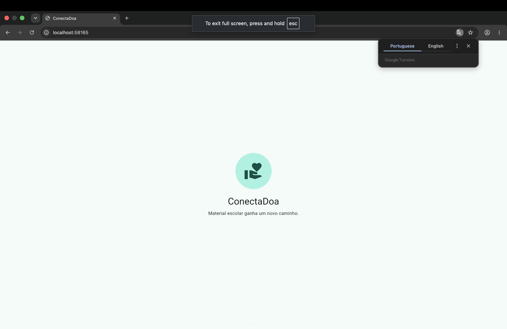
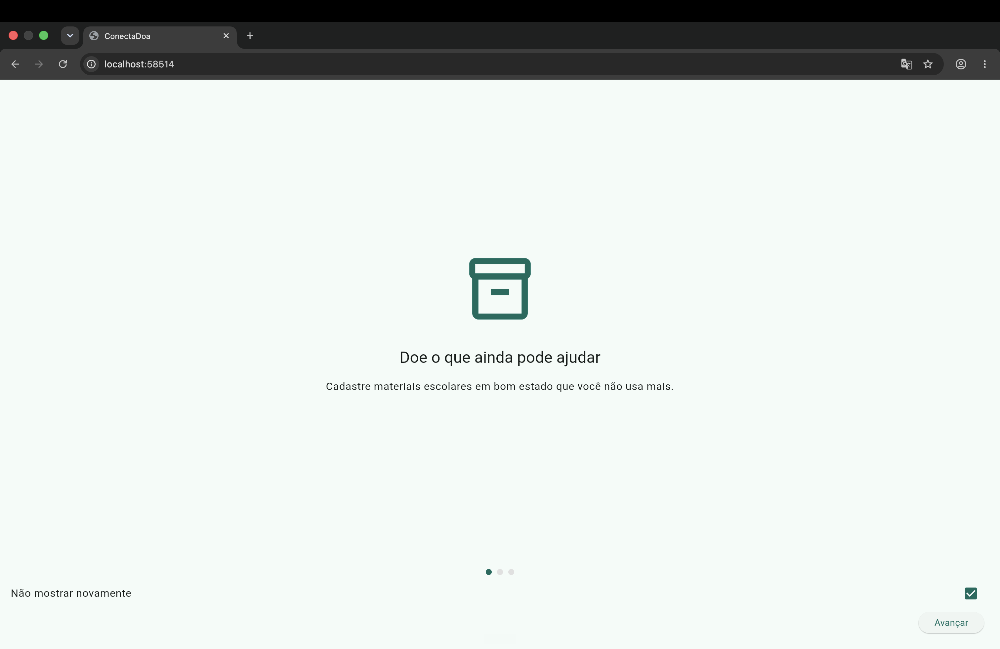
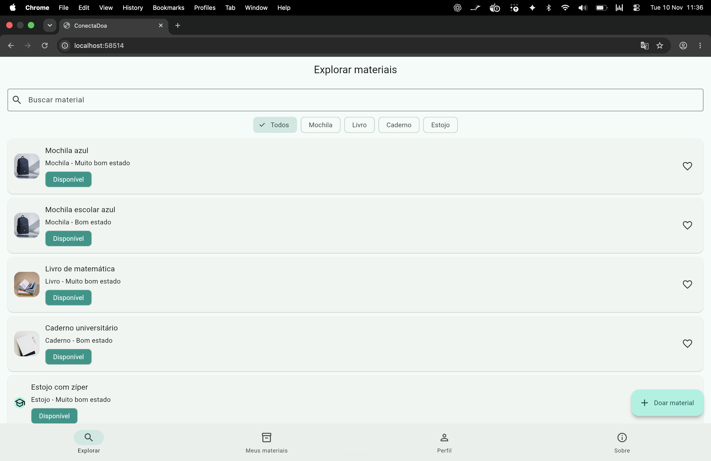
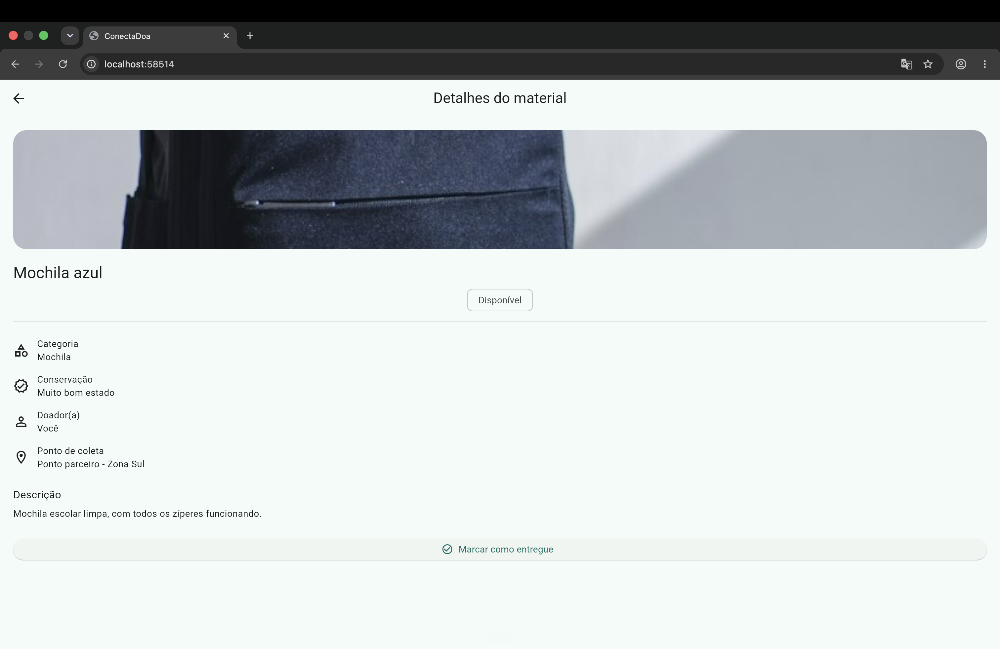
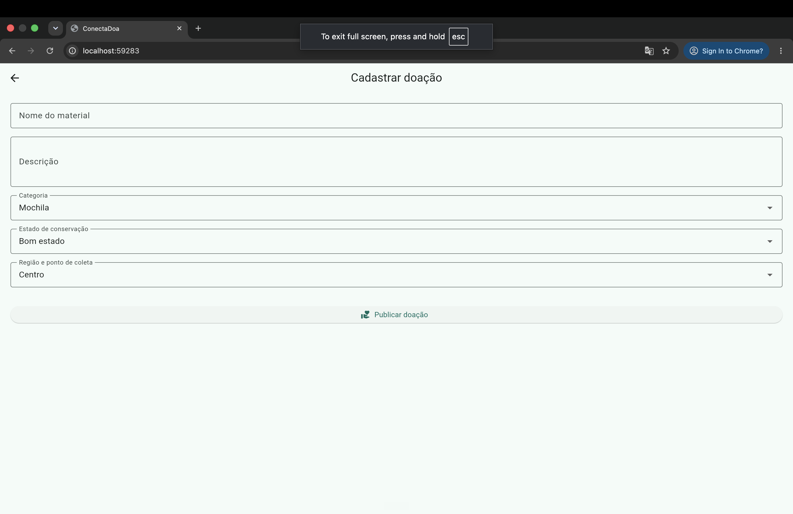
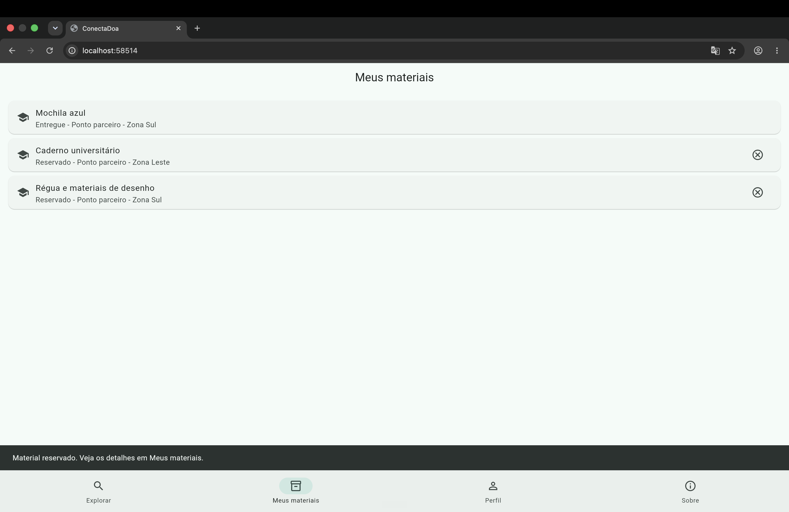
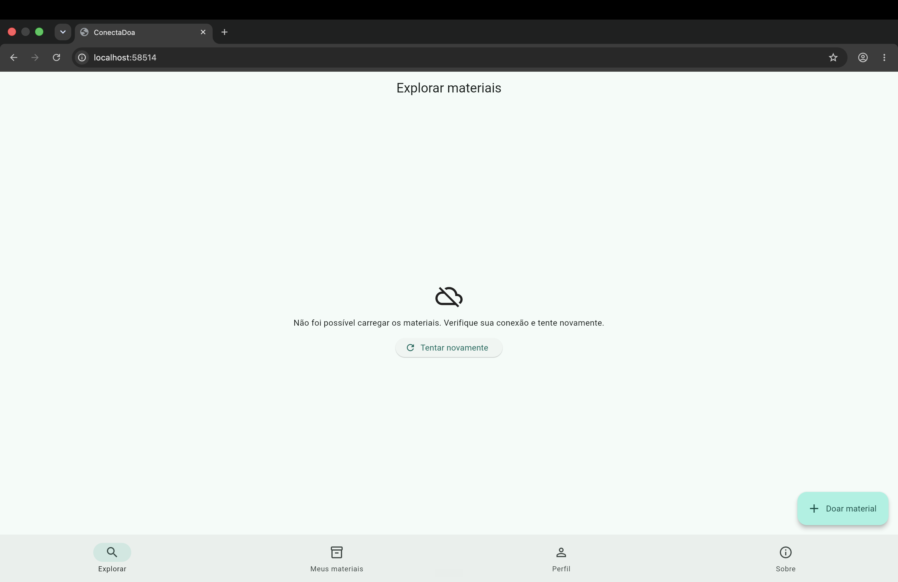

# ConectaDoa

Aplicativo mobile em Flutter que aproxima pessoas com materiais escolares em bom estado de pessoas que precisam desses materiais.

## Tema da Global Solution

O projeto propõe uma forma simples de prolongar o uso de mochilas, livros, cadernos e estojos, contribuindo com a **ODS 4 - Educação de Qualidade** e a **ODS 10 - Redução das Desigualdades**.

## Funcionalidades

- Splash com decisão de rota baseada em `SharedPreferences`.
- Onboarding de três páginas, com opção “Não mostrar novamente”.
- Catálogo de materiais obtido por API REST, com estados de carregamento, sucesso e erro com nova tentativa.
- Busca, filtro por categoria e favoritos.
- Detalhes e reserva de materiais; cancelamento da reserva antes da entrega.
- Cadastro de doação e marcação de entrega pelo doador.
- Área de materiais, perfil e informações do projeto.

## Fluxo de telas

`Splash → Onboarding (primeiro acesso) → Explorar → Detalhes → Reserva`  
`Explorar → Cadastrar doação → Meus materiais → Marcar como entregue`

As quatro telas principais são: **Explorar**, **Meus materiais**, **Perfil** e **Sobre**. O cadastro e os detalhes são telas complementares.

## API utilizada

O catálogo demonstra o consumo REST com `http`, usando o endpoint público [JSONPlaceholder Posts](https://jsonplaceholder.typicode.com/posts). Os campos recebidos são convertidos no model `MaterialItem` e apresentados como materiais escolares de demonstração.

## Arquitetura

```
lib/
  models/       modelo de material e status
  services/     chamada HTTP e conversão de JSON
  screens/      telas e navegação
  widgets/      componentes reutilizáveis
```

O estado de interface é controlado com `setState`; responsabilidades de dados ficam em `services` e `models`.

## Como executar

```bash
flutter pub get
flutter run -d chrome --web-hostname localhost --web-port 8080
```

O comando abre o navegador em `http://localhost:8080`.

## Prints das telas

Salve as capturas na pasta `docs/screenshots/` com os nomes abaixo. Após o envio para o GitHub, elas serão exibidas automaticamente neste README.

| Tela | Arquivo | Preview |
| --- | --- | --- |
| Splash | `01-splash.png` |  |
| Onboarding | `02-onboarding.png` |  |
| Explorar materiais | `03-explorar-materiais.png` |  |
| Detalhes do material | `04-detalhes-material.png` |  |
| Cadastrar doação | `05-cadastrar-doacao.png` |  |
| Meus materiais | `06-meus-materiais.png` |  |
| Estado de erro da API | `07-erro-api.png` |  |

## Desenvolvedores

| RM | Nome completo |
| --- | --- |
| 555288 | Vitor Amorim |
| 554789 | Lucas Campos Salles Santos |
| 554751 | Felipe Dyundi Takara |

## Vídeo pitch

Inserir o link do vídeo pitch conforme as orientações gerais da Global Solution antes da submissão.
